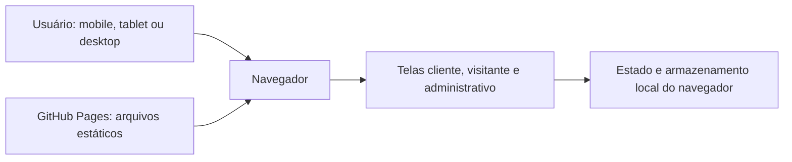

# Arquitetura atual do protótipo

HTML, CSS e JavaScript estáticos, publicados no GitHub Pages. Navegação e armazenamento no navegador simulam o sistema; não há backend bancário, fiscal ou autenticação real.

