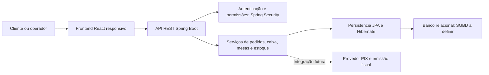

# Arquitetura prevista — proposta

Conforme tecnologias previstas no README: React.js e Java/Spring Boot, Spring Security/JWT e JPA/Hibernate. O SGBD permanece a definir. Integrações PIX e fiscais são futuras, sujeitas a decisão da equipe.

