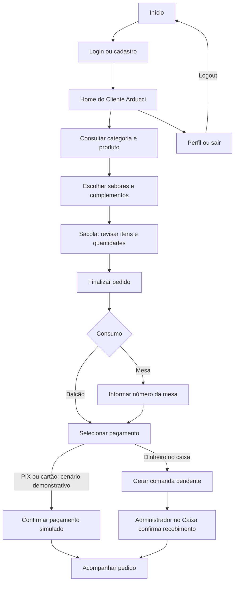

# Jornada de compra — Cliente Arducci

Referências: RF001–RF008.

Diagrama de cenário, elaborado para documentação. Cliente autenticado; cadastro novo mantém avatar vazio. Os cenários de cartão no protótipo não substituem o fluxo de cartão no caixa descrito no TCC.

[Editar fonte Mermaid](fluxo.mmd) · [Voltar ao índice](../README.md)
