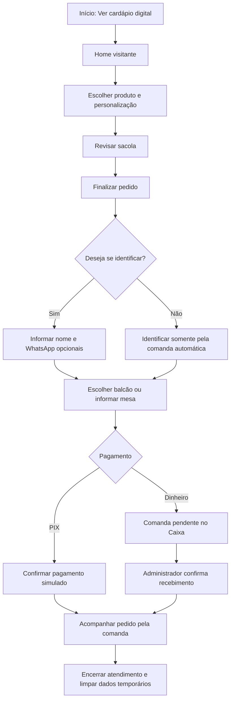

# Jornada de compra — Visitante

Referências: RF002–RF008.

Diagrama de cenário, elaborado para documentação. Visitante não acessa perfil. A exclusão de dados temporários é uma regra do cenário; retenção fiscal e financeira deve ser definida na implementação.

[Editar fonte Mermaid](fluxo.mmd) · [Voltar ao índice](../README.md)
