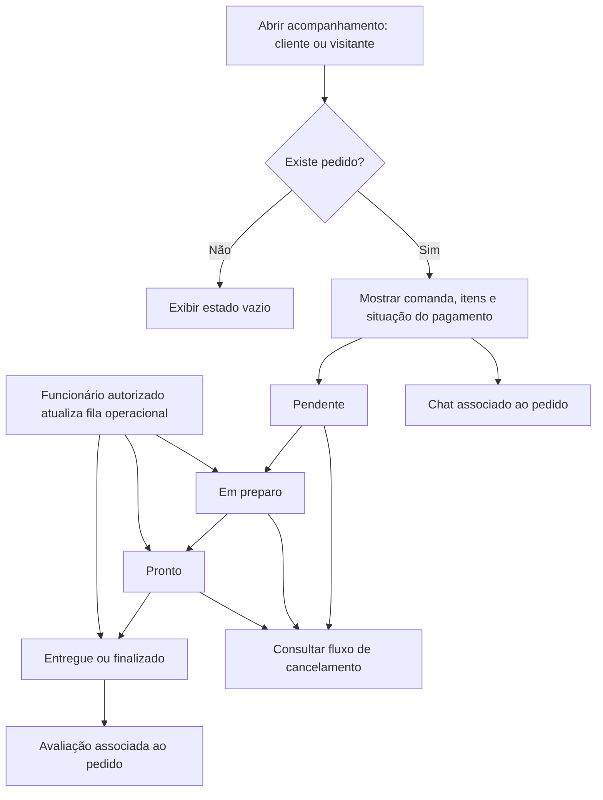

# Acompanhamento de pedido

Referências: RF012–RF013.

Diagrama de cenário, elaborado para documentação. Status do pedido e status financeiro são distintos. Chat e avaliação dependem de pedido existente. Cancelamento além de Pendente é evolução de cenário, de prioridade baixa.

[Editar fonte Mermaid](fluxo.mmd) · [Voltar ao índice](../README.md)
