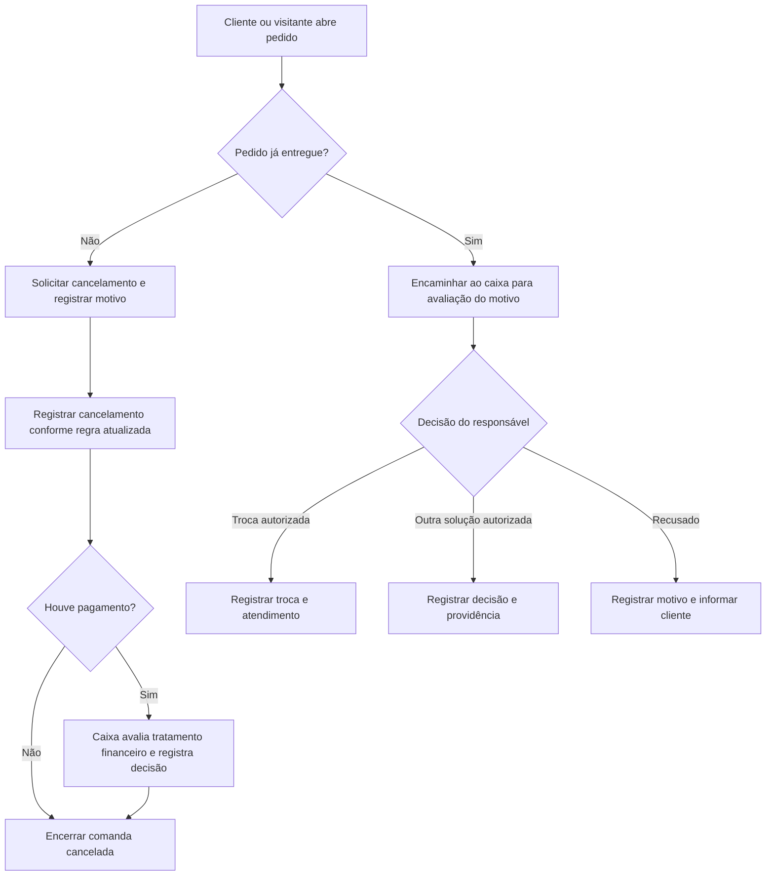

# Cancelamento e avaliação após entrega

Referências: RF009–RF010 e RF020.

Diagrama de cenário, elaborado para documentação. Regra atualizada pela equipe: pode cancelar antes da entrega; após a entrega é necessária avaliação, podendo haver troca. No protótipo a ação direta existe apenas em Pendente. Não presumir estorno bancário nem retorno automático de alimento já preparado ao estoque.

[Editar fonte Mermaid](fluxo.mmd) · [Voltar ao índice](../README.md)
