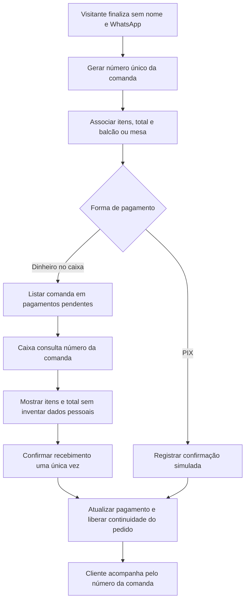

# Processamento de comanda sem dados pessoais

Referências: RF006–RF008 e RF014.

Diagrama de cenário, elaborado para documentação. Comanda é gerada em todos os pedidos. Nome e WhatsApp opcionais não impedem a compra. O TCC também prevê cartão no caixa. CPF só integra a opção fiscal quando solicitado.

[Editar fonte Mermaid](fluxo.mmd) · [Voltar ao índice](../README.md)
