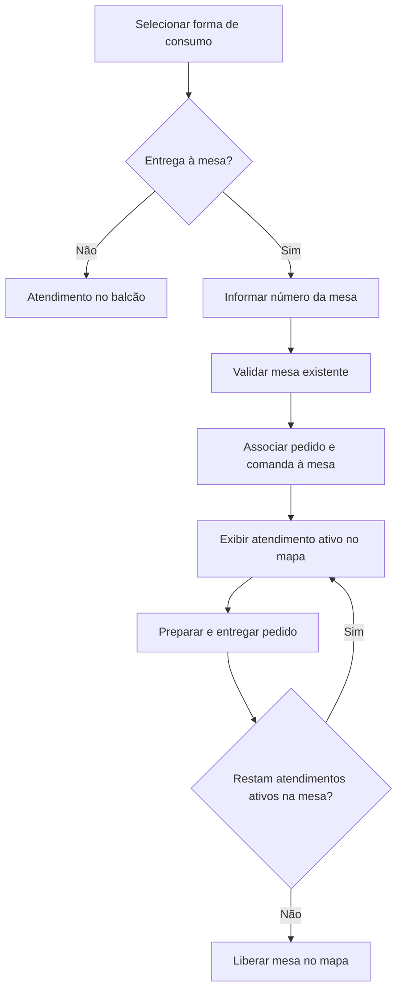

# Mapa de mesas e atendimento

Referências: RF007 e RF013.

Diagrama de cenário, elaborado para documentação. Mapa é operacional, sem delivery externo. Sincronização automática e liberação por todos os atendimentos ativos são propostas para implementação; não indicam integração já concluída.

[Editar fonte Mermaid](fluxo.mmd) · [Voltar ao índice](../README.md)
