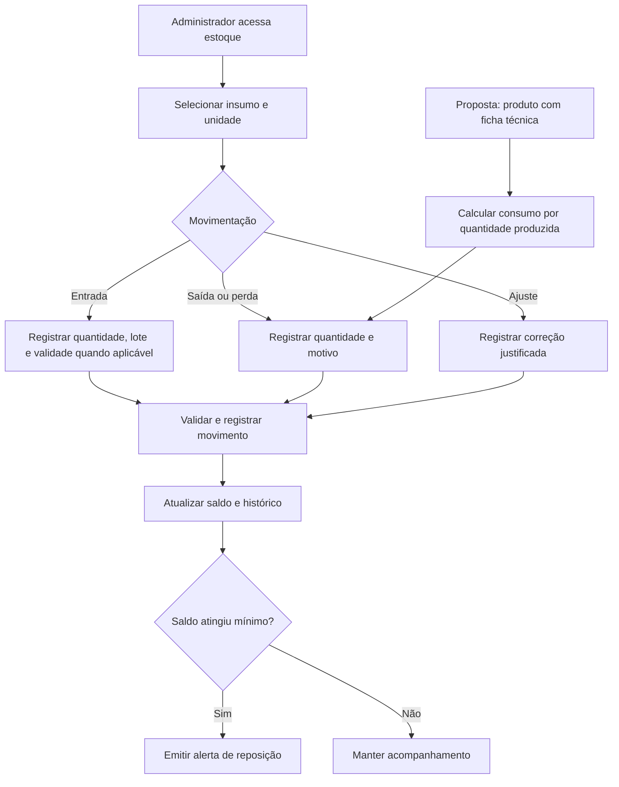

# Gestão de estoque — insumos e produtos

Referências: RF017–RF019.

Diagrama de cenário, elaborado para documentação. Entrada, saída e mínimo estão no TCC. Lotes, validade e baixa por ficha técnica são detalhamentos propostos. Validar unidade e saldo; cancelamento não repõe insumo consumido automaticamente.

[Editar fonte Mermaid](fluxo.mmd) · [Voltar ao índice](../README.md)
