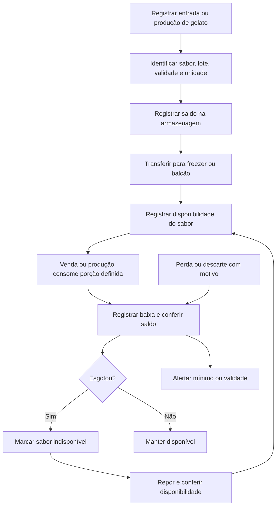

# Gestão de estoque — gelatos

Referências: RF015 e RF018–RF019.

Diagrama de cenário, elaborado para documentação. Funcionário autorizado atualiza disponibilidade; Administrador gerencia estoque. Integração de lotes, transferências e consumo por porção é proposta. Conversões entre litros, massa e porção precisam ser definidas, sem equivalência automática.

[Editar fonte Mermaid](fluxo.mmd) · [Voltar ao índice](../README.md)
