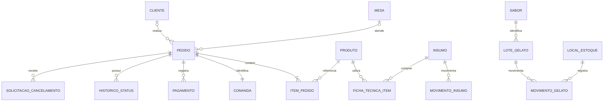

# Modelo conceitual complementar — proposta

Complemento de cenários, não substitui o modelo do TCC. Relação uma comanda por pedido corresponde à simulação atual; agrupamento futuro requer decisão da equipe. Cliente e mesa são opcionais no pedido.

Pagamentos podem registrar tentativas, com apenas uma liquidação efetiva por valor devido. Consumo por ficha técnica, locais e lotes de gelato são propostas de implementação. Nome/preço dos itens devem ter registro histórico; dados pessoais opcionais precisam de política própria de retenção.
