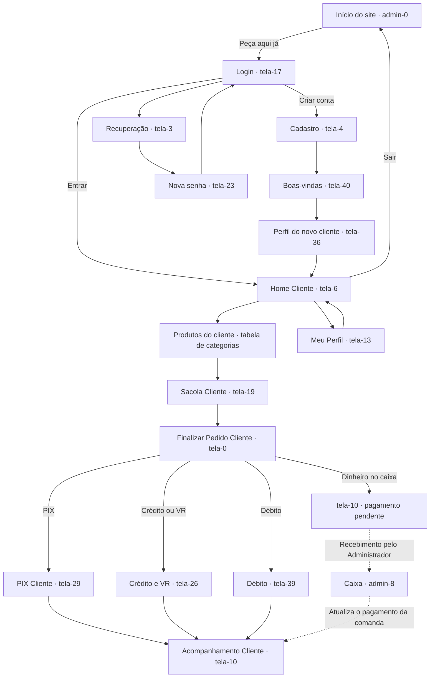

# Mapas de telas — Cliente Arducci e Visitante

**Projeto:** Automação e Gestão da Arducci  
**Referência técnica:** pasta `prototipo-mobile-desktop/`, commit `17805df72e02f2045c40d97623f3f6d43c145b5d`.  
**Finalidade:** apresentar os cenários e relacionar as telas aos requisitos do TCC.

[Consultar a matriz de requisitos](mapeamento-telas-requisitos.md).

## 1. Papéis dos cenários

- **Cliente Arducci:** pessoa cadastrada e logada, com acesso ao perfil e ao seu fluxo de pedidos.
- **Visitante:** pessoa que consulta o cardápio e faz pedido sem criar conta; nome e WhatsApp são opcionais e a comanda é automática.
- **Administrador:** reúne as funções de Caixa e Gerente; recebe pagamentos presenciais e conduz a gestão.
- **Funcionário:** possui funções operacionais específicas, com os bloqueios definidos no cenário administrativo.

As telas, pagamentos e dados apresentados pertencem ao protótipo de cenários. Os refinamentos documentais e ampliações apontados como baixa prioridade não bloqueiam sua apresentação.

## 2. Entrada compartilhada

| Ação | Origem | Destino | Requisitos |
| --- | --- | --- | --- |
| Peça aqui já | Início do site — `admin-0.html` | Login — `tela-17.html` | RF002 |
| Ver Cardápio Digital | Início do site — `admin-0.html` | Home do Visitante — `tela-34.html` | RF002, RF003 |
| Pedir Online sem Cadastro | Login — `tela-17.html` | Home do Visitante — `tela-34.html` | RF002, RF003 |
| Criar conta | Login — `tela-17.html` | Cadastro — `tela-4.html` | RF001 |

A entrada conectada dos cenários é `admin-0.html`. A página `tela-21.html` também permanece no catálogo como tela de apresentação.

## 3. Mapa do Cliente Arducci

A ligação com o Caixa representa o atendimento do pedido por **outro perfil**. A tela do cliente continua no acompanhamento; o cliente não precisa acessar o módulo administrativo para pagar.

### Telas e requisitos do cliente

| Etapa | Arquivo | Finalidade | Requisitos |
| --- | --- | --- | --- |
| Login | `tela-17.html` | Entrada na conta de demonstração. | RF002 |
| Cadastro | `tela-4.html` | Informar os dados do novo cliente. | RF001 |
| Boas-vindas | `tela-40.html` | Confirmação visual do cadastro. | RF001 |
| Novo perfil claro / escuro | `tela-36.html` / `tela-5.html` | Apresentar o novo cliente, com avatar vazio. | RF001; preferências complementares |
| Home | `tela-6.html` | Consultar as categorias do cardápio. | RF003 |
| Produtos | Consultar a tabela de categorias. | Escolher o produto e suas opções. | RF003, RF004 |
| Sacola | `tela-19.html` | Quantidades, remoção, total e observações. | RF005, RF006, RF007 |
| Finalização | `tela-0.html` | Rever pedido e escolher recebimento/pagamento. | RF006, RF007, RF008 |
| PIX | `tela-29.html` | Cenário de pagamento PIX. | RF007 |
| Crédito/VR e débito | `tela-26.html` / `tela-39.html` | Cenários de cartão do cliente logado. | RF007, RF008 — canal a consolidar |
| Acompanhamento | `tela-10.html` | Status, cancelamento no cenário representado, avaliação e chat. | RF009, RF010; relação com RF012/RF013 |
| Perfil claro / escuro | `tela-13.html` / `tela-16.html` | Perfil do cliente e prévia de preferências. | RF002; funções complementares |
| Recuperação / nova senha | `tela-3.html` / `tela-23.html` | Cenário demonstrativo de recuperação. | RF002 |

**Menu fixo do cliente:** Início → `tela-6`; Sacola → `tela-19`; Pedidos → `tela-10`; Perfil → `tela-13`.

**Tema do perfil:** a prévia escura usa `tela-16` no perfil usual ou `tela-5` no perfil do novo cliente. Manter confirma a prévia; Cancelar retorna à tela clara de origem. Essa preferência é demonstrativa.

## 4. Mapa do Visitante

```mermaid
flowchart TD
    IN["Início do site · admin-0"] -->|Ver Cardápio Digital| HOME["Home Visitante · tela-34"]
    LOGIN["Login · tela-17"] -->|Pedir Online sem Cadastro| HOME
    HOME --> PRODUCTS["Produtos do visitante · tabela de categorias"]
    PRODUCTS --> BAG["Sacola Visitante · tela-33"]
    BAG --> FINAL["Finalizar Pedido Visitante · tela-25"]
    FINAL -->|PIX| PIX["PIX Visitante · tela-20"]
    PIX --> ORDER["Acompanhamento Visitante · tela-24"]
    FINAL -->|Dinheiro no caixa| PENDING["tela-24 · pagamento pendente"]
    PENDING -. Recebimento pelo Administrador .-> CASH["Caixa · admin-8"]
    CASH -. Atualiza o pagamento da comanda .-> ORDER
    HOME -->|Entrar na conta| LOGIN
    ORDER -->|Encerrar acompanhamento| IN
```

### Telas e regras do visitante

| Etapa | Arquivo | Finalidade | Requisitos |
| --- | --- | --- | --- |
| Home | `tela-34.html` | Consultar o cardápio sem criar conta. | RF002, RF003 |
| Produtos | Consultar a tabela de categorias. | Escolher os produtos e suas opções no modo visitante. | RF003, RF004 |
| Sacola | `tela-33.html` | Rever itens, quantidades, total e observações. | RF005, RF006, RF007 |
| Finalização | `tela-25.html` | Identificação opcional, comanda automática, local de consumo e pagamento. | RF006, RF007, RF008 |
| PIX | `tela-20.html` | Cenário de pagamento PIX do visitante. | RF007 |
| Dinheiro | `tela-25.html` → pedido pendente → `admin-8.html` | Enviar pedido ao Caixa; o Administrador recebe e confirma. | RF007, RF008, RF014 com ator do cenário |
| Acompanhamento | `tela-24.html` | Visualizar o pedido, status, avaliação, chat e encerramento. | RF009, RF010; relação com RF012/RF013 |

**Menu fixo do visitante:** Início → `tela-34`; Sacola → `tela-33`; Pedidos → `tela-24`; **Perfil bloqueado, sem rota**.

- Nome e WhatsApp são opcionais. A comanda automática do resumo identifica o pedido quando esses campos não são preenchidos.
- O visitante usa PIX ou dinheiro no Caixa no cenário atual. A seleção de cartão dentro do aplicativo fica indisponível nesse modo.
- O perfil Administrador pode usar as formas de recebimento do Caixa ao atender uma comanda.
- Avaliação e chat exigem um pedido existente; não ficam disponíveis no acompanhamento vazio.
- A sessão de visitante é temporária e segue a política de encerramento/expiração definida para a demonstração.

## 5. Correspondência entre as categorias

Todos os nomes de arquivo abaixo pertencem à pasta `prototipo-mobile-desktop/`.

| Categoria | Cliente Arducci | Visitante | Relação com requisitos |
| --- | --- | --- | --- |
| Self Service | `tela-35.html` | `tela-7.html` | RF003; opções do produto conforme o cenário |
| Açaíteria | `tela-15.html` | `tela-37.html` | RF003, RF004 |
| Cascão e Casquinha | `tela-14.html` | `tela-22.html` | RF003, RF004 |
| Picolés | `tela-11.html` | `tela-38.html` | RF003, RF004 |
| Paletas Recheadas | `tela-18.html` | `tela-30.html` | RF003, RF004 |
| Potes para Viagem | `tela-12.html` | `tela-2.html` | RF003, RF004 |
| Petit Gateau | `tela-27.html` | `tela-1.html` | RF003, RF004 |
| Banana Split | `tela-41.html` | `tela-8.html` | RF003, RF004 |
| Milk Shake | `tela-31.html` | `tela-32.html` | RF003, RF004 |
| Bebidas | `tela-28.html` | `tela-9.html` | RF003; seleção de itens |

O botão Voltar e a ação de continuar comprando devem preservar o modo: cliente retorna à Home `tela-6`; visitante retorna à Home `tela-34`.

## 6. Etapas e regras compartilhadas

### Personalização e sacola

- Mínimo de um sabor nas escolhas de gelato.
- Cascão/Casquinha: limite conforme formato/tamanho escolhido.
- Petit Gateau: um a dois sabores.
- Banana Split: um a três sabores; as três bolas podem repetir um sabor.
- Milk Shake: um a dois sabores, com informação sobre a combinação.
- Sacola com inclusão, quantidade, remoção e observações; o total acompanha os itens selecionados.

### Local de recebimento

Cliente e visitante escolhem **retirada no balcão** ou **receber na mesa**. Ao escolher mesa, informam o número, que deve acompanhar o pedido e a comanda. O cenário atual não inclui delivery externo.

### Dinheiro e Caixa

1. Cliente ou visitante envia o pedido para pagar no caixa.
2. O pedido recebe comanda e estado de pagamento pendente.
3. O **Administrador (Caixa/Gerente)** abre o ícone de pagamentos pendentes em `admin-8.html`.
4. A comanda carrega itens, número e nome/WhatsApp quando informados.
5. O recebimento confirmado atualiza o pagamento do pedido.

### Cancelamento e atendimento pós-entrega

**Regra dos cenários informada:** antes da entrega o cliente pode cancelar; depois da entrega o motivo deve ser avaliado, podendo haver troca.

**Representação atual:** a ação de cancelamento do aplicativo está implementada em Pendente, com motivo e confirmação. A extensão aos demais estados anteriores à entrega e o detalhamento da avaliação/troca após a entrega ficam como **refinamentos de baixa prioridade**.

As caixas de avaliação e chat permanecem ligadas ao pedido existente. Não devem ser confundidas com uma autorização formal de troca já implementada.

## 7. Comparação dos modos

| Função | Cliente Arducci | Visitante |
| --- | --- | --- |
| Entrada | Login ou cadastro | Cardápio Digital ou acesso sem cadastro |
| Home | `tela-6.html` | `tela-34.html` |
| Categorias | Telas do cliente | Telas correspondentes do visitante |
| Sacola | `tela-19.html` | `tela-33.html` |
| Finalização | `tela-0.html` | `tela-25.html` |
| Identificação | Perfil de demonstração do cliente | Nome/WhatsApp opcionais e comanda automática |
| Perfil | Disponível | Bloqueado |
| PIX | `tela-29.html` | `tela-20.html` |
| Cartão no aplicativo | Cenários `tela-26` e `tela-39` | Indisponível no aplicativo |
| Dinheiro no Caixa | Disponível | Disponível |
| Número da mesa | Solicitado ao escolher mesa | Solicitado ao escolher mesa |
| Acompanhamento | `tela-10.html` | `tela-24.html` |
| Avaliação/chat | Ligados ao pedido | Ligados ao pedido |
| Encerramento | Sair → início compartilhado | Encerrar acompanhamento → início compartilhado |

## 8. Roteiros para apresentação

1. **Cliente cadastrado:** login → categoria → personalização → sacola → finalização → PIX → acompanhamento.
2. **Novo cliente:** cadastro → boas-vindas → perfil novo → cardápio.
3. **Visitante sem identificação:** Cardápio Digital → produto → sacola → finalização com campos opcionais vazios → comanda automática → PIX.
4. **Visitante identificado com dinheiro:** informar nome/WhatsApp → enviar para pagar no caixa → Administrador abre pendência → comanda preenchida → confirmar recebimento.
5. **Consumo na mesa:** escolher Receber na mesa → informar número → conferir a informação no acompanhamento e no Caixa.
6. **Pedido existente:** abrir avaliação/chat a partir do acompanhamento; conferir que não há essas ações em um acompanhamento vazio.
7. **Cancelamento representado:** demonstrar Pendente, motivo, confirmação e estado cancelado; apresentar como evolução de baixa prioridade a ampliação até a entrega e o atendimento/troca após a entrega.

Os roteiros organizam a apresentação dos cenários e não equivalem a testes de aceitação da versão final já aprovados.

## 9. Acessos

- [Apresentação mobile](https://fatecrl-ite004.github.io/Automatiza-o-Arducci-Gelateria/prototipo-mobile-desktop/?device=mobile)
- [Apresentação tablet](https://fatecrl-ite004.github.io/Automatiza-o-Arducci-Gelateria/prototipo-mobile-desktop/?device=tablet)
- [Apresentação desktop](https://fatecrl-ite004.github.io/Automatiza-o-Arducci-Gelateria/prototipo-mobile-desktop/?device=desktop)

Na Wiki, esta página pode ser chamada **Mapa do Cliente e do Visitante**. No repositório, mantenha o arquivo em `docs/rastreabilidade/` junto da matriz de requisitos.
